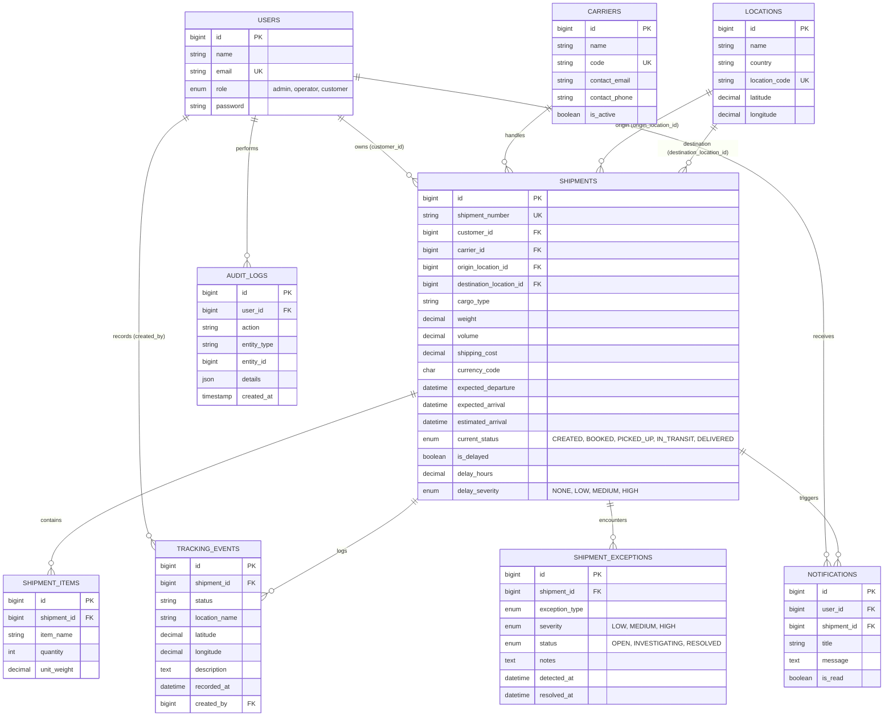

# CargoTrace: Global Shipment Visibility & Tracking Platform

## Project Overview

**CargoTrace** is a full-stack Laravel 13 web and REST API platform for end-to-end global shipment visibility, real-time route tracking, delay/ETA monitoring, exception management, and multi-role logistics operations. It is built with a clean **Service Layer architecture**, separating business rules from thin Web/API Controllers and enforcing strict server-side authorization.

---

## Features

- **Role-Based Access Control (RBAC)** via middleware (`RoleMiddleware`) & policies (`ShipmentPolicy`):
  - **Admin**: Full access to Users, Carriers, Locations, Shipments, Tracking, Exceptions, Reports, and Audit Logs.
  - **Operator**: Create/update shipments, append chronological tracking events, and manage exception workflows.
  - **Customer**: View only their own shipments, live route maps, timelines, reports, and notifications.
- **Strict Shipment Lifecycle**: Enforces sequential transitions (`CREATED -> BOOKED -> PICKED_UP -> IN_TRANSIT -> DELIVERED`) and rejects invalid jumps or backward transitions from terminal states.
- **Append-Only Tracking Timeline**: Records historical `tracking_events` with chronological validation (`recorded_at` cannot precede the latest event), automatic shipment status sync, and customer notifications.
- **ETA & Delay Severity Engine**: Calculates delay hours against configurable `CARGOTRACE_DELAY_THRESHOLD_HOURS` (default `12` hours) and classifies severity (`NONE`, `LOW` 0–6h, `MEDIUM` >6–24h, `HIGH` >24h).
- **Exception Management**: Enforces `OPEN -> INVESTIGATING -> RESOLVED` workflow with `detected_at` / `resolved_at` timestamps and customer notifications.
- **External API Integrations** (5-second timeout & graceful fallback):
  - **OpenWeatherMap API**: Live weather conditions at destination or latest tracking coordinates.
  - **ExchangeRate API**: Real-time `shipping_cost` conversion across global currencies (`USD`, `EUR`, `SGD`, `AUD`, `IDR`).
- **Interactive Dashboard & Exports**: Dynamic Chart.js analytics, Leaflet.js (OpenStreetMap) route maps, server-side search/filter/sort/pagination, and CSV export.
- **Sanctum REST API**: Token-based authentication and standardized JSON responses (`200`, `201`, `401`, `403`, `404`, `422`).

---

## System Architecture

```text
app/
├── Http/
│   ├── Controllers/
│   │   ├── Api/               # Sanctum REST API Controllers + ApiResponseTrait
│   │   ├── Admin/             # Carrier, Location, User, AuditLog Web Controllers
│   │   ├── Auth/              # Session Login/Logout
│   │   └── ...                # Dashboard, Shipment, Tracking, Exception, Report, Notification
│   ├── Middleware/
│   │   └── RoleMiddleware.php # Multi-role route guard
│   └── Requests/              # Form Request validation classes
├── Models/                    # 9 Eloquent models with relationships
├── Policies/
│   └── ShipmentPolicy.php     # Customer isolation & role-based authorization
└── Services/                  # Business logic layer
    ├── AuditLogService.php
    ├── CarrierService.php
    ├── EtaService.php
    ├── ExternalApiService.php
    ├── LocationService.php
    ├── NotificationService.php
    ├── ShipmentExceptionService.php
    ├── ShipmentService.php
    ├── TrackingEventService.php
    └── UserService.php
```

---

## Entity Relationship Diagram (ERD)



---

## Data Dictionary

| Table | Purpose | Key Columns |
| :--- | :--- | :--- |
| `users` | System accounts & roles | `id`, `name`, `email`, `role` (`admin`/`operator`/`customer`), `password` |
| `carriers` | Logistics & shipping carriers | `id`, `name`, `code`, `contact_email`, `contact_phone`, `is_active` |
| `locations` | Global ports and cities | `id`, `name`, `country`, `location_code`, `latitude`, `longitude` |
| `shipments` | Core shipment records & ETA state | `id`, `shipment_number`, `customer_id`, `carrier_id`, `origin_location_id`, `destination_location_id`, `current_status`, `is_delayed`, `delay_hours`, `delay_severity` |
| `shipment_items` | Cargo line items per shipment | `id`, `shipment_id`, `item_name`, `quantity`, `unit_weight` |
| `tracking_events` | Append-only shipment checkpoints | `id`, `shipment_id`, `status`, `location_name`, `latitude`, `longitude`, `recorded_at`, `created_by` |
| `shipment_exceptions` | Operational incidents & resolutions | `id`, `shipment_id`, `exception_type`, `severity`, `status`, `detected_at`, `resolved_at` |
| `notifications` | User alerts for status & exceptions | `id`, `user_id`, `shipment_id`, `title`, `message`, `is_read` |
| `audit_logs` | Immutable system activity trail | `id`, `user_id`, `action`, `entity_type`, `entity_id`, `details`, `created_at` |

---

## Setup Instructions

1. **Clone / Open Project**:
   ```bash
   cd C:/xampp/htdocs/cargotrace
   ```
2. **Install Dependencies**:
   ```bash
   composer install
   ```
3. **Environment Configuration**:
   ```bash
   cp .env.example .env
   php artisan key:generate
   ```
   Update `.env` with your MySQL credentials (`DB_DATABASE=cargotrace_db`) and optional API keys:
   ```env
   CARGOTRACE_DELAY_THRESHOLD_HOURS=12
   OPENWEATHERMAP_API_KEY=your_openweathermap_key
   EXCHANGERATE_API_KEY=your_exchangerate_key
   ```
4. **Run Migrations & Seeders**:
   ```bash
   php artisan migrate --seed
   ```
5. **Start Development Server**:
   ```bash
   php artisan serve
   ```
   Visit `http://127.0.0.1:8000` in your browser.

---

## Demo Accounts

All seeded demo accounts use the password: `password`

| Role | Email | Access Scope |
| :--- | :--- | :--- |
| **Admin** | `admin@cargotrace.test` | Full system access, Carriers, Locations, Users, Audit Logs |
| **Operator** | `operator@cargotrace.test` | Create/update shipments, append tracking events, manage exceptions |
| **Customer** | `customer@cargotrace.test` | View own shipments, route maps, timelines, and notifications |

---

## Running Automated Tests

Run the full PHPUnit test suite (covering Business Rules, Web Frontend & RBAC, and Sanctum REST API):

```bash
php artisan test
```

---

## API Summary

All protected endpoints require `Authorization: Bearer <token>` and `Accept: application/json`.

| Method | Endpoint | Access | Description |
| :--- | :--- | :--- | :--- |
| `POST` | `/api/register` | Public | Register a new customer account & return token |
| `POST` | `/api/login` | Public | Authenticate user & issue Sanctum Bearer token |
| `POST` | `/api/logout` | Authenticated | Revoke current access token |
| `GET` | `/api/user` | Authenticated | Get authenticated user profile |
| `GET` | `/api/shipments` | Authenticated | List shipments (role-scoped, filterable, paginated) |
| `POST` | `/api/shipments` | Admin, Operator | Create a new shipment (with optional items) |
| `GET` | `/api/shipments/{id}` | Policy (`view`) | Get shipment details (403 for other customers) |
| `PUT/PATCH` | `/api/shipments/{id}` | Admin, Operator | Update shipment / strict status transition |
| `DELETE` | `/api/shipments/{id}` | Admin | Delete shipment |
| `GET` | `/api/shipments/{id}/tracking` | Policy (`view`) | List chronological tracking events |
| `POST` | `/api/shipments/{id}/tracking` | Admin, Operator | Append new tracking event |
| `GET` | `/api/shipments/{id}/exceptions` | Policy (`view`) | List shipment exceptions |
| `POST` | `/api/shipments/{id}/exceptions` | Admin, Operator | Report a new exception |
| `PATCH` | `/api/exceptions/{id}` | Admin, Operator | Advance exception (`OPEN -> INVESTIGATING -> RESOLVED`) |
| `GET` | `/api/carriers` | Authenticated | List all carriers |
| `POST` | `/api/carriers` | Admin | Create a new carrier |
| `GET` | `/api/locations` | Authenticated | List all global locations |
| `POST` | `/api/locations` | Admin | Create a new location |

Import [`postman_collection.json`](./postman_collection.json) into Postman to test all endpoints immediately.

---

## External Library Attributions

- **[Laravel Framework (v13)](https://laravel.com)** & **[Laravel Sanctum](https://laravel.com/docs/sanctum)** — MIT License
- **[Tailwind CSS](https://tailwindcss.com)** — MIT License
- **[Chart.js](https://www.chartjs.org)** — MIT License
- **[Leaflet.js](https://leafletjs.com)** — BSD 2-Clause License
- **[OpenStreetMap](https://www.openstreetmap.org/copyright)** — ODbL (Map Tiles)
- **[OpenWeatherMap API](https://openweathermap.org/api)** — Weather data provider
- **[ExchangeRate-API](https://www.exchangerate-api.com)** — Currency conversion provider

---

## Deployment Guide

1. Set `APP_ENV=production` and `APP_DEBUG=false` in `.env`.
2. Ensure `.env` is never committed to version control (protected by `.gitignore`).
3. Run optimizations:
   ```bash
   composer install --no-dev --optimize-autoloader
   php artisan migrate --force
   php artisan config:cache
   php artisan route:cache
   php artisan view:cache
   ```
4. Point your web server (Nginx/Apache) document root to `/public` and configure HTTPS.
