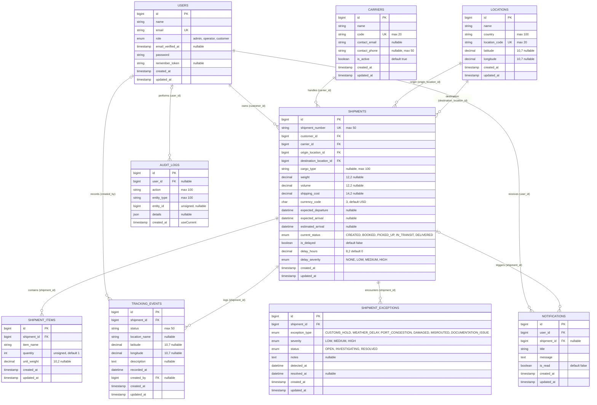

# CargoTrace: Global Shipment Visibility & Tracking Platform

## Project Overview

**CargoTrace** is a full-stack Laravel 13 web and REST API platform for end-to-end global shipment visibility, real-time route tracking, delay/ETA monitoring, exception management, and multi-role logistics operations. It is built with a clean **Service Layer architecture**, separating business rules from thin Web/API Controllers and enforcing strict server-side authorization.

- **Live Demo**: [https://web-production-005737b3.up.railway.app](https://web-production-005737b3.up.railway.app)
- **Demo Credentials**: `operator@cargotrace.test` / `customer@cargotrace.test` (password: `password`) — see [Demo Accounts](#demo-accounts) below.

---

## Features

- **Role-Based Access Control (RBAC)** via middleware (`RoleMiddleware`) & policies (`ShipmentPolicy`):
  - **Admin**: Full access to Users, Carriers, Locations, Shipments, Tracking, Exceptions, Reports, and Audit Logs.
  - **Operator**: Create/update shipments, append chronological tracking events, and manage exception workflows.
  - **Customer**: View only their own shipments, live route maps, timelines, reports, and notifications.
- **Strict Shipment Lifecycle**: Enforces sequential transitions (`CREATED -> BOOKED -> PICKED_UP -> IN_TRANSIT -> DELIVERED`) and rejects invalid jumps or backward transitions from terminal states.
- **Append-Only Tracking Timeline**: Records historical `tracking_events` with chronological validation (`recorded_at` cannot precede the latest event), automatic shipment status sync, and customer notifications.
- **ETA & Delay Severity Engine**: Calculates delay hours against configurable `CARGOTRACE_DELAY_THRESHOLD_HOURS` (default `12` hours) and classifies severity (`NONE`, `LOW` 0–6h, `MEDIUM` >6–24h, `HIGH` >24h).
- **Exception Management**: Enforces `OPEN -> INVESTIGATING -> RESOLVED` workflow with `detected_at` / `resolved_at` timestamps and customer notifications.
- **External API Integrations** (5-second timeout & graceful fallback):
  - **OpenWeatherMap API**: Live weather conditions at destination or latest tracking coordinates.
  - **ExchangeRate API**: Real-time `shipping_cost` conversion across global currencies (`USD`, `EUR`, `SGD`, `AUD`, `IDR`).
- **Interactive Dashboard & Exports**: Dynamic Chart.js analytics, Leaflet.js (OpenStreetMap) route maps, server-side search/filter/sort/pagination, and CSV export.
- **Sanctum REST API**: Token-based authentication and standardized JSON responses (`200`, `201`, `401`, `403`, `404`, `422`).

---

## System Architecture

```text
app/
├── Http/
│   ├── Controllers/
│   │   ├── Api/               # Sanctum REST API Controllers + ApiResponseTrait
│   │   ├── Admin/             # Carrier, Location, User, AuditLog Web Controllers
│   │   ├── Auth/              # Session Login/Logout
│   │   └── ...                # Dashboard, Shipment, Tracking, Exception, Report, Notification
│   ├── Middleware/
│   │   └── RoleMiddleware.php # Multi-role route guard
│   └── Requests/              # Form Request validation classes
├── Models/                    # 9 Eloquent models with relationships
├── Policies/
│   └── ShipmentPolicy.php     # Customer isolation & role-based authorization
└── Services/                  # Business logic layer
    ├── AuditLogService.php
    ├── CarrierService.php
    ├── EtaService.php
    ├── ExternalApiService.php
    ├── LocationService.php
    ├── NotificationService.php
    ├── ShipmentExceptionService.php
    ├── ShipmentService.php
    ├── TrackingEventService.php
    └── UserService.php
```

---

## Entity Relationship Diagram (ERD)



---

## Data Dictionary

### 1. `users`
System user accounts, authentication credentials, and RBAC roles (`App\Models\User`).

| Column | Type | Nullable | Default / Constraints | Description |
| :--- | :--- | :--- | :--- | :--- |
| `id` | `bigint unsigned` | No | `PK`, `AUTO_INCREMENT` | Primary identifier |
| `name` | `varchar(255)` | No | — | Full name of the user |
| `email` | `varchar(255)` | No | `UNIQUE` | Login email address |
| `role` | `enum('admin','operator','customer')` | No | `DEFAULT 'customer'`, `INDEX` | User authorization role |
| `email_verified_at` | `timestamp` | Yes | `NULL` | Email verification timestamp |
| `password` | `varchar(255)` | No | — | Hashed password (`hashed` cast) |
| `remember_token` | `varchar(100)` | Yes | `NULL` | Session remember-me token |
| `created_at` | `timestamp` | Yes | `NULL` | Record creation timestamp |
| `updated_at` | `timestamp` | Yes | `NULL` | Record last update timestamp |

### 2. `carriers`
Logistics and shipping carrier partners (`App\Models\Carrier`).

| Column | Type | Nullable | Default / Constraints | Description |
| :--- | :--- | :--- | :--- | :--- |
| `id` | `bigint unsigned` | No | `PK`, `AUTO_INCREMENT` | Primary identifier |
| `name` | `varchar(255)` | No | — | Carrier company name |
| `code` | `varchar(20)` | No | `UNIQUE` | Short unique carrier code (e.g. `MAERSK`) |
| `contact_email` | `varchar(255)` | Yes | `NULL` | Carrier support email |
| `contact_phone` | `varchar(50)` | Yes | `NULL` | Carrier support phone number |
| `is_active` | `boolean` | No | `DEFAULT true`, `INDEX` | Whether the carrier is active |
| `created_at` | `timestamp` | Yes | `NULL` | Record creation timestamp |
| `updated_at` | `timestamp` | Yes | `NULL` | Record last update timestamp |

### 3. `locations`
Global ports, hubs, and cities with coordinates (`App\Models\Location`).

| Column | Type | Nullable | Default / Constraints | Description |
| :--- | :--- | :--- | :--- | :--- |
| `id` | `bigint unsigned` | No | `PK`, `AUTO_INCREMENT` | Primary identifier |
| `name` | `varchar(255)` | No | `INDEX (country, name)` | City or port name |
| `country` | `varchar(100)` | No | `INDEX (country, name)` | Country name |
| `location_code` | `varchar(20)` | No | `UNIQUE` | Standardized port/city code (e.g. `SGSIN`) |
| `latitude` | `decimal(10,7)` | Yes | `NULL` | Geographic latitude |
| `longitude` | `decimal(10,7)` | Yes | `NULL` | Geographic longitude |
| `created_at` | `timestamp` | Yes | `NULL` | Record creation timestamp |
| `updated_at` | `timestamp` | Yes | `NULL` | Record last update timestamp |

### 4. `shipments`
Core shipment records, route references, costs, and ETA/delay state (`App\Models\Shipment`).

| Column | Type | Nullable | Default / Constraints | Description |
| :--- | :--- | :--- | :--- | :--- |
| `id` | `bigint unsigned` | No | `PK`, `AUTO_INCREMENT` | Primary identifier |
| `shipment_number` | `varchar(50)` | No | `UNIQUE` | Unique tracking/waybill number |
| `customer_id` | `bigint unsigned` | No | `FK -> users.id (CASCADE)`, `INDEX (customer_id, current_status)` | Owning customer user |
| `carrier_id` | `bigint unsigned` | No | `FK -> carriers.id (RESTRICT)` | Assigned shipping carrier |
| `origin_location_id` | `bigint unsigned` | No | `FK -> locations.id (RESTRICT)` | Origin port/city |
| `destination_location_id` | `bigint unsigned` | No | `FK -> locations.id (RESTRICT)` | Destination port/city |
| `cargo_type` | `varchar(100)` | Yes | `NULL` | Cargo category/description |
| `weight` | `decimal(12,2)` | Yes | `NULL` | Total shipment weight |
| `volume` | `decimal(12,2)` | Yes | `NULL` | Total shipment volume |
| `shipping_cost` | `decimal(14,2)` | Yes | `NULL` | Shipping cost amount |
| `currency_code` | `char(3)` | No | `DEFAULT 'USD'` | ISO 4217 currency code |
| `expected_departure` | `datetime` | Yes | `NULL` | Scheduled departure timestamp |
| `expected_arrival` | `datetime` | Yes | `NULL` | Baseline expected arrival timestamp |
| `estimated_arrival` | `datetime` | Yes | `NULL` | Current estimated arrival (ETA) timestamp |
| `current_status` | `enum('CREATED','BOOKED','PICKED_UP','IN_TRANSIT','DELIVERED')` | No | `DEFAULT 'CREATED'`, `INDEX` | Current lifecycle status |
| `is_delayed` | `boolean` | No | `DEFAULT false`, `INDEX` | Delay flag computed against threshold |
| `delay_hours` | `decimal(8,2)` | No | `DEFAULT 0` | Calculated delay duration in hours |
| `delay_severity` | `enum('NONE','LOW','MEDIUM','HIGH')` | No | `DEFAULT 'NONE'` | Delay severity classification |
| `created_at` | `timestamp` | Yes | `NULL` | Record creation timestamp |
| `updated_at` | `timestamp` | Yes | `NULL` | Record last update timestamp |

### 5. `shipment_items`
Cargo line items belonging to a shipment (`App\Models\ShipmentItem`).

| Column | Type | Nullable | Default / Constraints | Description |
| :--- | :--- | :--- | :--- | :--- |
| `id` | `bigint unsigned` | No | `PK`, `AUTO_INCREMENT` | Primary identifier |
| `shipment_id` | `bigint unsigned` | No | `FK -> shipments.id (CASCADE)` | Parent shipment |
| `item_name` | `varchar(255)` | No | — | Name/description of cargo item |
| `quantity` | `int unsigned` | No | `DEFAULT 1` | Item quantity |
| `unit_weight` | `decimal(10,2)` | Yes | `NULL` | Weight per unit |
| `created_at` | `timestamp` | Yes | `NULL` | Record creation timestamp |
| `updated_at` | `timestamp` | Yes | `NULL` | Record last update timestamp |

### 6. `tracking_events`
Append-only chronological shipment checkpoints (`App\Models\TrackingEvent`).

| Column | Type | Nullable | Default / Constraints | Description |
| :--- | :--- | :--- | :--- | :--- |
| `id` | `bigint unsigned` | No | `PK`, `AUTO_INCREMENT` | Primary identifier |
| `shipment_id` | `bigint unsigned` | No | `FK -> shipments.id (CASCADE)`, `INDEX (shipment_id, recorded_at)` | Parent shipment |
| `status` | `varchar(50)` | No | — | Checkpoint status code |
| `location_name` | `varchar(255)` | Yes | `NULL` | Checkpoint location label |
| `latitude` | `decimal(10,7)` | Yes | `NULL` | Checkpoint latitude |
| `longitude` | `decimal(10,7)` | Yes | `NULL` | Checkpoint longitude |
| `description` | `text` | Yes | `NULL` | Event details/remarks |
| `recorded_at` | `datetime` | No | `INDEX` | Chronological event timestamp |
| `created_by` | `bigint unsigned` | Yes | `FK -> users.id (SET NULL)` | Operator/admin who logged the event |
| `created_at` | `timestamp` | Yes | `NULL` | Record creation timestamp |
| `updated_at` | `timestamp` | Yes | `NULL` | Record last update timestamp |

### 7. `shipment_exceptions`
Operational incidents and resolution workflow per shipment (`App\Models\ShipmentException`).

| Column | Type | Nullable | Default / Constraints | Description |
| :--- | :--- | :--- | :--- | :--- |
| `id` | `bigint unsigned` | No | `PK`, `AUTO_INCREMENT` | Primary identifier |
| `shipment_id` | `bigint unsigned` | No | `FK -> shipments.id (CASCADE)`, `INDEX (shipment_id, status)` | Affected shipment |
| `exception_type` | `enum('CUSTOMS_HOLD','WEATHER_DELAY','PORT_CONGESTION','DAMAGED','MISROUTED','DOCUMENTATION_ISSUE')` | No | — | Category of operational exception |
| `severity` | `enum('LOW','MEDIUM','HIGH')` | No | — | Impact severity level |
| `status` | `enum('OPEN','INVESTIGATING','RESOLVED')` | No | `DEFAULT 'OPEN'`, `INDEX` | Exception resolution state |
| `notes` | `text` | Yes | `NULL` | Investigation or resolution notes |
| `detected_at` | `datetime` | No | — | Timestamp when exception was detected |
| `resolved_at` | `datetime` | Yes | `NULL` | Timestamp when exception was resolved |
| `created_at` | `timestamp` | Yes | `NULL` | Record creation timestamp |
| `updated_at` | `timestamp` | Yes | `NULL` | Record last update timestamp |

### 8. `notifications`
In-app user alerts triggered by shipment updates and exceptions (`App\Models\Notification`).

| Column | Type | Nullable | Default / Constraints | Description |
| :--- | :--- | :--- | :--- | :--- |
| `id` | `bigint unsigned` | No | `PK`, `AUTO_INCREMENT` | Primary identifier |
| `user_id` | `bigint unsigned` | No | `FK -> users.id (CASCADE)`, `INDEX (user_id, is_read)` | Recipient user |
| `shipment_id` | `bigint unsigned` | Yes | `FK -> shipments.id (CASCADE)` | Related shipment (optional) |
| `title` | `varchar(255)` | No | — | Notification headline |
| `message` | `text` | No | — | Notification body text |
| `is_read` | `boolean` | No | `DEFAULT false`, `INDEX` | Read status flag |
| `created_at` | `timestamp` | Yes | `NULL` | Record creation timestamp |
| `updated_at` | `timestamp` | Yes | `NULL` | Record last update timestamp |

### 9. `audit_logs`
Immutable system activity trail (`App\Models\AuditLog`, `UPDATED_AT = null`).

| Column | Type | Nullable | Default / Constraints | Description |
| :--- | :--- | :--- | :--- | :--- |
| `id` | `bigint unsigned` | No | `PK`, `AUTO_INCREMENT` | Primary identifier |
| `user_id` | `bigint unsigned` | Yes | `FK -> users.id (SET NULL)` | Actor who performed the action |
| `action` | `varchar(100)` | No | — | Action identifier (e.g. `shipment.created`) |
| `entity_type` | `varchar(100)` | No | `INDEX (entity_type, entity_id)` | Target entity/model name |
| `entity_id` | `bigint unsigned` | Yes | `NULL`, `INDEX (entity_type, entity_id)` | Target entity primary ID |
| `details` | `json` | Yes | `NULL` | Structured metadata payload (`array` cast) |
| `created_at` | `timestamp` | No | `DEFAULT CURRENT_TIMESTAMP`, `INDEX` | Event timestamp |

---

## Setup Instructions

1. **Clone / Open Project**:
   ```bash
   cd C:/xampp/htdocs/cargotrace
   ```
2. **Install Dependencies**:
   ```bash
   composer install
   ```
3. **Environment Configuration**:
   ```bash
   cp .env.example .env
   php artisan key:generate
   ```
   Update `.env` with your MySQL credentials (`DB_DATABASE=cargotrace_db`) and optional API keys:
   ```env
   CARGOTRACE_DELAY_THRESHOLD_HOURS=12
   OPENWEATHERMAP_API_KEY=your_openweathermap_key
   EXCHANGERATE_API_KEY=your_exchangerate_key
   ```
4. **Run Migrations & Seeders**:
   ```bash
   php artisan migrate --seed
   ```
5. **Start Development Server**:
   ```bash
   php artisan serve
   ```
   Visit `http://127.0.0.1:8000` in your browser.

---

## Demo Accounts

All seeded demo accounts use the password: `password`

| Role | Email | Access Scope |
| :--- | :--- | :--- |
| **Admin** | `admin@cargotrace.test` | Full system access, Carriers, Locations, Users, Audit Logs |
| **Operator** | `operator@cargotrace.test` | Create/update shipments, append tracking events, manage exceptions |
| **Customer** | `customer@cargotrace.test` | View own shipments, route maps, timelines, and notifications |

---

## Running Automated Tests

Run the full PHPUnit test suite (covering Business Rules, Web Frontend & RBAC, and Sanctum REST API):

```bash
php artisan test
```

---

## API Summary

All protected endpoints require `Authorization: Bearer <token>` and `Accept: application/json`.

| Method | Endpoint | Access | Description |
| :--- | :--- | :--- | :--- |
| `POST` | `/api/register` | Public | Register a new customer account & return token |
| `POST` | `/api/login` | Public | Authenticate user & issue Sanctum Bearer token |
| `POST` | `/api/logout` | Authenticated | Revoke current access token |
| `GET` | `/api/user` | Authenticated | Get authenticated user profile |
| `GET` | `/api/shipments` | Authenticated | List shipments (role-scoped, filterable, paginated) |
| `POST` | `/api/shipments` | Admin, Operator | Create a new shipment (with optional items) |
| `GET` | `/api/shipments/{id}` | Policy (`view`) | Get shipment details (403 for other customers) |
| `PUT/PATCH` | `/api/shipments/{id}` | Admin, Operator | Update shipment / strict status transition |
| `DELETE` | `/api/shipments/{id}` | Admin | Delete shipment |
| `GET` | `/api/shipments/{id}/tracking` | Policy (`view`) | List chronological tracking events |
| `POST` | `/api/shipments/{id}/tracking` | Admin, Operator | Append new tracking event |
| `GET` | `/api/shipments/{id}/exceptions` | Policy (`view`) | List shipment exceptions |
| `POST` | `/api/shipments/{id}/exceptions` | Admin, Operator | Report a new exception |
| `PATCH` | `/api/exceptions/{id}` | Admin, Operator | Advance exception (`OPEN -> INVESTIGATING -> RESOLVED`) |
| `GET` | `/api/carriers` | Authenticated | List all carriers |
| `POST` | `/api/carriers` | Admin | Create a new carrier |
| `GET` | `/api/locations` | Authenticated | List all global locations |
| `POST` | `/api/locations` | Admin | Create a new location |

Import [`postman_collection.json`](./postman_collection.json) into Postman to test all endpoints immediately.

---

## External Library Attributions

- **[Laravel Framework (v13)](https://laravel.com)** & **[Laravel Sanctum](https://laravel.com/docs/sanctum)** — MIT License
- **[Tailwind CSS](https://tailwindcss.com)** — MIT License
- **[Chart.js](https://www.chartjs.org)** — MIT License
- **[Leaflet.js](https://leafletjs.com)** — BSD 2-Clause License
- **[OpenStreetMap](https://www.openstreetmap.org/copyright)** — ODbL (Map Tiles)
- **[OpenWeatherMap API](https://openweathermap.org/api)** — Weather data provider
- **[ExchangeRate-API](https://www.exchangerate-api.com)** — Currency conversion provider

---

## Deployment Guide

1. Set `APP_ENV=production` and `APP_DEBUG=false` in `.env`.
2. Ensure `.env` is never committed to version control (protected by `.gitignore`).
3. Run optimizations:
   ```bash
   composer install --no-dev --optimize-autoloader
   php artisan migrate --force
   php artisan config:cache
   php artisan route:cache
   php artisan view:cache
   ```
4. Point your web server (Nginx/Apache) document root to `/public` and configure HTTPS.
